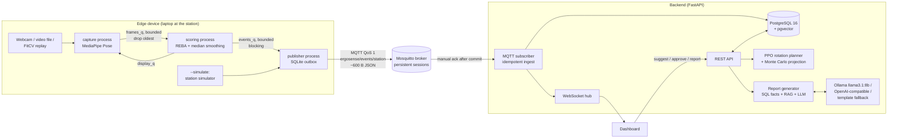
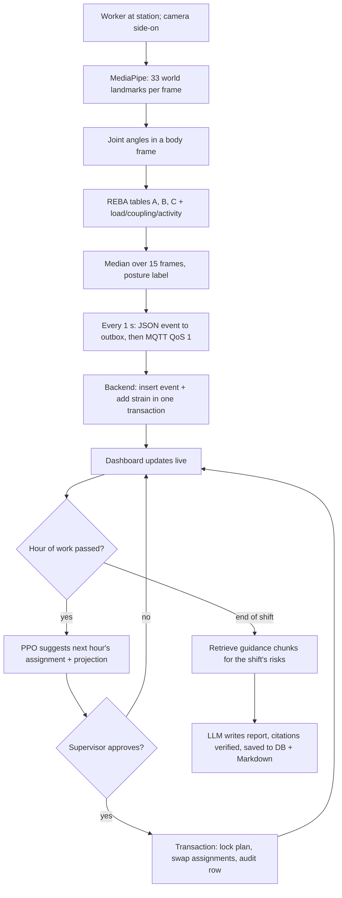

# ERGOSENSE — industrial worker ergonomic safety system

*UN SDG 9 (Industry, Innovation and Infrastructure) · built on top of [FitCV](FITCV_README.md)*

A webcam watches a worker at a workstation. The edge device scores posture risk with **REBA** and streams
small JSON events, never video, over **MQTT**. A **FastAPI** backend stores them in **PostgreSQL** and
tracks every worker's cumulative strain across the shift. A **reinforcement-learning (PPO)** planner suggests
job rotations so nobody exceeds a safe strain limit, and a supervisor approves them on a live dashboard. At the
end of the shift an **LLM with RAG** over ergonomic guidance writes a safety report in which every
recommendation cites a verified source.


---

## 1. Problem statement

**Context.** Work-related musculoskeletal disorders (low-back, shoulder and wrist injuries) are the most
common occupational health problem in manufacturing, warehousing and logistics. They are caused by
cumulative exposure to awkward postures, such as deep bending, overhead reaching, twisting and lifting from the floor,
repeated over whole shifts. Ergonomists assess this with observational methods like **REBA**, but on paper and
only a few times a year. Day-to-day exposure stays invisible, and work rotation is planned by habit rather
than by measured load.

**Problem.** How can a factory continuously measure each worker's posture risk with cheap, existing hardware,
without filming people, and use that measurement to keep every worker's cumulative strain below a safe limit?

**Relevance to SDG 9.** Target 9.4 asks industries to upgrade with clean, efficient technologies, and target 9.5
asks for more research and innovation in industry. ERGOSENSE is low-cost, retrofittable industrial
infrastructure (a webcam, a laptop and open-source software) that makes production lines safer and more
productive. It also supports SDG 8.8 (safe and secure working environments).

## 2. Objectives and outcomes

| # | Objective (measurable) | Result |
|---|---|---|
| O1 | Score whole-body posture risk with REBA from a single webcam in real time, with segment scores and risk level, validated on constructed and real poses | Done: 21 REBA tests incl. real FitCV recordings (bent-over rows score far above upright curls; squats > 90° knee flexion) |
| O2 | Deliver posture events edge → database with **no loss** during broker or backend outages, using < 1 KB per event | ~600 B/event (≈1,540× smaller than a raw frame); 0 events lost and 0 out of order in outage tests |
| O3 | Keep per-worker cumulative strain consistent under duplicates and concurrent approvals | Idempotent ingest + single-transaction approval with row lock; 9 database tests |
| O4 | Learn a rotation policy that lowers the peak worker strain below the no-rotation, round-robin and greedy baselines on 500 seeded shifts, respecting training constraints | PPO peak 400 vs 691 / 532 / 437 (see §8) |
| O5 | Produce an end-of-shift report in which **every** cited source is verified against the retrieved guidance | Citation checker removes and flags any unverified id; template fallback if no LLM |

## 3. Architecture



### Methodology flow (one shift)



## 4. How each technology is used

| Technology | Where | How it is used |
|---|---|---|
| **DBMS** (mandatory) | `ergosense/backend/schema.sql`, `repository.py`, `rotation.py` | Normalised schema (junction table for training), temporal assignment history, CHECK/UNIQUE/partial-unique constraints as business rules, composite + partial + HNSW + GIN indexes, idempotent `ON CONFLICT` ingest, **single-transaction plan approval with `SELECT … FOR UPDATE`**, JSONB, pgvector |
| **Reinforcement learning** (mandatory) | `ergosense/rl/` | Gymnasium environment (8 hourly decisions, 4 workers × 4 stations, `Discrete(24)` permutations with training masks), telescoping reward, MaskablePPO training, 3 baselines, 500-shift seeded evaluation, live planner with Monte Carlo projection; one station calibrated from real REBA data in the database |
| **System design** (mandatory) | whole repo | Edge computing, broker-decoupled pipeline, station-based attribution, human-in-the-loop approval, graceful degradation at every layer (outbox, persistent session, greedy/keyword/template fallbacks) |
| **Computer networks** (mandatory) | `ergosense/edge/publisher.py`, `outbox.py`, `backend/ingest.py`, `live.py` | MQTT pub/sub with QoS 1, sliding window of in-flight messages, store-and-forward outbox, persistent sessions, ack-after-commit, idempotency keys, WebSockets for server push; bandwidth measured |
| **Generative AI** (mandatory) | `ergosense/assistant/` | Local LLM (Ollama) or any OpenAI-compatible API writes a structured report from SQL facts; low temperature, grounded prompt, citation verification, clearly labelled template fallback |
| Computer vision | `ergosense/edge/capture.py`, `reba.py` | MediaPipe Pose world landmarks → body-frame joint angles → REBA |
| RAG | `ergosense/assistant/ingest.py`, `retriever.py` | Section-level chunks of 3 reference documents, MiniLM embeddings in pgvector, topic-driven retrieval, keyword (full-text) fallback |
| OS concepts | `ergosense/edge/pipeline.py`, `proc.py` | Three processes, bounded producer–consumer queues with different back-pressure policies, poison-pill shutdown, shared memory values |

### Reused from FitCV
FitCV's `features.calculate_angle` (elbow, wrist and knee angles), its MediaPipe Pose setup and pinned working
version set (mediapipe 0.10.21 + numpy 1.26.4), its skeleton-drawing approach, and its **recorded pose dataset**:
replayed through the pipeline as real human poses for testing (`--replay`), REBA validation and RL calibration.
FitCV's own apps (`app.py`, `main.py`, `offline_eval.py`) are untouched and still run in the same environment.

## 5. Repository layout

```
docker-compose.yml           Postgres 16 + pgvector, Mosquitto 2.0 (ports bound to 127.0.0.1)
infra/mosquitto/             broker config (listener, persistence)
.env.example                 all settings (DB URL, MQTT, strain limit, LLM, RAG)
ergosense/
  config.py  events.py  strain.py   settings, event contract, strain rule
  edge/      reba.py capture.py scoring.py publisher.py outbox.py simulate.py pipeline.py overlay.py
  backend/   schema.sql seed.sql init_db.py main.py ingest.py repository.py rotation.py live.py db.py
  rl/        env.py policies.py train.py evaluate.py calibrate.py planner.py stations.py models/ results/
  assistant/ docs/ ingest.py retriever.py embeddings.py llm.py report.py reports/
  dashboard/ index.html app.js styles.css markdown.js
  tests/     54 tests
  e2e_check.py                  end-to-end check of the whole system
docs/        VIVA_NOTES.md  RUBRIC_MAP.md
(FitCV)      app.py main.py model.py train.py dataset/ weights/ ...  -> FITCV_README.md
```

## 6. Setup

Needs **Docker Desktop** and **Python 3.10**. All commands run from the repo root.

**Windows (PowerShell or the VS Code terminal):**
```bash
py -3.10 -m venv .venv
.venv\Scripts\Activate.ps1
pip install -r ergosense/requirements.txt
Copy-Item .env.example .env
docker compose up -d
python -m ergosense.backend.init_db
python -m ergosense.assistant.ingest
```
If PowerShell blocks `Activate.ps1`, run `Set-ExecutionPolicy -Scope CurrentUser RemoteSigned` once.

**Mac/Linux:** the same, except `python3.10 -m venv .venv`, `source .venv/bin/activate` and `cp .env.example .env`.

`docker compose ps` should show both containers as `healthy`. The trained PPO model and station profiles are
committed, so training is optional (`python -m ergosense.rl.train`, about 4 minutes on a CPU).

**Optional, a real LLM for the report:** install Ollama (https://ollama.com/download), then run
`ollama pull llama3.1:8b`. With `LLM_PROVIDER=auto` in `.env`, it is used automatically. Any
OpenAI-compatible API also works: set `OPENAI_API_KEY`, `OPENAI_BASE_URL` and `OPENAI_MODEL`.

## 7. Running

Open three terminals in the repo root, each with the venv activated.

| Terminal | Command | What it does |
|---|---|---|
| 1 | `python -m uvicorn ergosense.backend.main:app --port 8000` | backend, MQTT subscriber, dashboard at http://127.0.0.1:8000 (API docs at `/docs`) |
| 2 | `python -m ergosense.edge.pipeline --simulate --stations S1,S2,S3 --speed 60` | simulated cameras at three stations (1 real second = 1 minute of work) |
| 3 | `python -m ergosense.edge.pipeline --station S4 --demo-speed 60 --load-kg 8` | **webcam** at the loading bay, with the OpenCV window (press Q to quit) |

Other edge sources: `--video clip.mp4` (a recorded video through the same code path), `--replay dataset/BentOverRow`
(FitCV recordings), `--simulate` (all four stations). Useful options: `--camera 1`, `--worker W04`, `--coupling 2`,
`--no-window`. Run `python -m ergosense.edge.pipeline --help` for all of them.

Other commands: `python -m pytest` (all tests) · `python -m ergosense.e2e_check` (whole system, about 1 minute) ·
`python -m ergosense.rl.evaluate` · `python -m ergosense.assistant.report` ·
`python -m ergosense.backend.init_db --new-shift` (fresh shift) · `--reset` (wipe everything).

### Demo script (about 8 minutes)
1. `docker compose ps` (both containers healthy) → start the backend (terminal 1) → open the dashboard.
2. `python -m ergosense.backend.init_db --new-shift` for a clean shift, then refresh the dashboard.
3. Start the simulated stations (terminal 2). Cards, strain bars and the event feed update live.
4. Start the webcam at S4 (terminal 3). Stand side-on, then stand upright, bend down to "lift" a box, reach
   overhead, and squat. The OpenCV skeleton changes colour with the REBA risk, and Karan's (W04) card follows.
5. Point out the bandwidth line in the OpenCV window: about 600 B per event vs about 900 KB per frame, and no video leaves the laptop.
6. **Network resilience:** run `docker compose stop mosquitto`. The edge says OFFLINE and keeps buffering. Then run
   `docker compose start mosquitto`, and every buffered event arrives (the event feed catches up, nothing is lost).
7. After about an hour of simulated work, click **Suggest rotation**. Explain the table: who moves where, and the
   projected end-of-shift strain with and without rotation. Click **Approve**. Try approving again from `/docs`
   to show the 409 (the transaction plus row lock).
8. Repeat the suggestion every simulated hour. Once the shift is over, click **Generate report** and show the
   verified citations and the Sources section.
9. Show `ergosense/rl/results/policy_comparison.png` and run `python -m pytest` (54 tests).

## 8. Evaluation results

**REBA validation.** Hand-built skeletons score as the REBA tables predict: neutral standing 1, deep bend with
neck extension 5 (medium) and 8 (high) with 15 kg, overhead reach 3, or 4 with raised shoulders. On FitCV's real
recordings, bent-over rows average far higher than upright curls and squats reach > 90° of knee flexion.

**Networking.** The average event is ~600 B, against 921,600 B for a raw 640×480 frame (≈1,540× smaller), which is
~600 B/s per camera vs ~13.8 MB/s of raw 15-FPS video. With the broker stopped for ~13 s, 96 events were buffered on disk
and all 192 were delivered in order. With the backend stopped, the broker queued 48 events and delivered them
on restart.

**Rotation policies (500 seeded 8-hour shifts, same seeds for every policy).** Generated by
`python -m ergosense.rl.evaluate` (`ergosense/rl/results/summary.csv`):

| Policy | Final peak strain | Workers over limit (of 4) | Shifts with anyone over limit | Total strain | Workers moved |
|---|---|---|---|---|---|
| No rotation | 691 ± 75 | 1.67 ± 0.47 | 100% | 1513 ± 93 | 0.0 |
| Round-robin | 532 ± 62 | 1.53 ± 0.61 | 100% | 1511 ± 86 | 26.5 |
| Greedy | 437 ± 35 | 1.65 ± 0.98 | 86% | 1506 ± 84 | 11.9 |
| **PPO (ours)** | 400 ± 25 | 0.78 ± 0.99 | 48% | 1502 ± 82 | 10.1 |

PPO lowers the average final peak by 42% vs no rotation and 8% vs greedy, has 53% fewer workers over the limit than greedy, and moves people 16% less often. It still cannot prevent every exceedance: shifts start with random strain and hidden worker sensitivity, and the safe limit is only ~15% above the perfectly balanced load.

**Station calibration from real data.** The loading bay (S4) was replayed from 528 real FitCV pose events
through the full pipeline with an 8 kg load: **81.8 strain/h**, within 6% of the 77.4 strain/h in our
hand-built station simulator. The other stations use simulator defaults (see `ergosense/rl/station_profiles.json`).

**Live end-to-end run** (`python -m ergosense.e2e_check`, one PPO suggestion per hour, approved when anyone
moves): 4 rotations approved over the shift (hours with nothing to gain were skipped); actual end-of-shift peak **362**, against 370 projected by the planner at hour 2 with hourly planning and **632** projected with no rotation. Nobody ended above the 400 limit. 10/10 checks passed.

**Report.** Every report lists its sources. In tests, a fake LLM answer citing a non-existent chunk had that
citation removed and flagged, and recommendations left without a verified source are marked.

### Discussion
- PPO lowers the **peak** worker strain and the number of workers over the limit, with fewer moves than
  greedy or round-robin. It learns to delay rotations when they are not yet needed, because every move has a cost.
- **Total strain is the same for every policy.** Rotation shares exposure but cannot remove it. The report
  therefore always recommends engineering fixes (raising pallets, lowering overhead work) for the station
  that dominates exposure.
- Round-robin performs badly once training constraints exist, because a fixed cycle cannot respect who can do which job.
- The planner's projection assumes the supervisor asks for a suggestion every hour. A single rotation
  early in the shift is not enough (we observed this in testing).

## 9. Design decisions (and where we deviated from the brief)
- **Port 5433** for Postgres (5432 is often taken by a local install), and **`127.0.0.1`, not `localhost`**,
  everywhere: on Windows `localhost` tries IPv6 first and each connection stalled about 10 s.
- **pgvector** (in the `pgvector/pgvector:pg16` image) instead of FAISS, so vectors live in the same transactional database.
- `trained_stations` is a **junction table** (`worker_training`), shown as an array by the `workers_v` view (1NF + foreign keys).
- Extra columns beyond the brief: `posture_events.shift_id/duration_s/angles/source/edge_seq`;
  `shift_strain.exposure_s/risky_s`; `rotation_plans.projection`; a `shift_assignments` history table and a `safety_reports` table.
- Events from fixed station cameras may carry `worker_id = null`. The backend attributes them to whoever was
  assigned to the station at the event's timestamp.
- **Strain rule:** `strain += weight(risk) × minutes`, with weights 0 / 0.5 / 1 / 2 / 4. The safe limit is **400** (see `ergosense/strain.py`).
- Added a **"leaning"** label (trunk flexion 20–60°). Otherwise a loaded forward lean could score "high" but be labelled "neutral".
- REBA tuning from real data: a **15° neck neutral offset**, and **side-bend ignored in side-on views**, where it is
  measured along the unreliable depth axis.
- The RL environment adds hidden per-worker sensitivity (0.85–1.20), random starting strain and training
  constraints, so that policies must adapt instead of following a fixed timetable.
- The simulator publishes **accelerated time** (`--speed`). The webcam has `--demo-speed` so a short demo produces visible strain.
- Shift reports are written in local time; the database stores UTC.

## 10. Limitations
- **REBA from a single webcam is an approximation.** Depth is the least reliable axis (place the camera side-on or at
  45°), wrist detail is coarse, and load, grip quality and shoulder elevation cannot be seen, so they are command-line inputs.
- **RL results come from simulation.** Station dynamics are modelled; one station is calibrated on real poses (exercise
  recordings standing in for lifting), and individual worker sensitivity is unknown in live use.
- **Task/posture labels are rule-based** thresholds on angles, not a trained classifier. One person per camera.
- The strain weights and the 400-point limit are project design parameters, not clinical thresholds.
- Big Data, cloud deployment and NLP beyond report generation are deliberately out of scope. Authentication and TLS
  are not configured (everything is bound to localhost).

## 11. API

`GET /health` · `GET /workers` · `GET /stations` · `GET /shifts/active` · `GET /shifts/{id}/strain` ·
`GET /events?worker_id=&limit=` · `GET /state` · `POST /rotation/suggest` · `POST /rotation/{plan_id}/approve`
(`{"approved_by": "..."}`) · `GET /rotation/plans` · `POST /report/{shift_id}` · `GET /reports/{id}` · `WS /ws`.
Interactive docs: http://127.0.0.1:8000/docs

## 12. Testing
`python -m pytest`: 54 tests, about 25 s (database tests use a separate `ergosense_test` database and skip if
Docker is down). `ergosense-ci.yml` runs them on GitHub Actions with a Postgres service. `python -m ergosense.e2e_check`
exercises the running system end to end.

## Attribution
FitCV (pose pipeline, dataset, models): see [FITCV_README.md](FITCV_README.md). ERGOSENSE was built on top of it as
a semester project. REBA: Hignett & McAtamney (2000), *Applied Ergonomics* 31(2). NIOSH lifting equation: Waters et al.
(1993), *Ergonomics* 36(7). The reference documents in `ergosense/assistant/docs/` are our own summaries.
