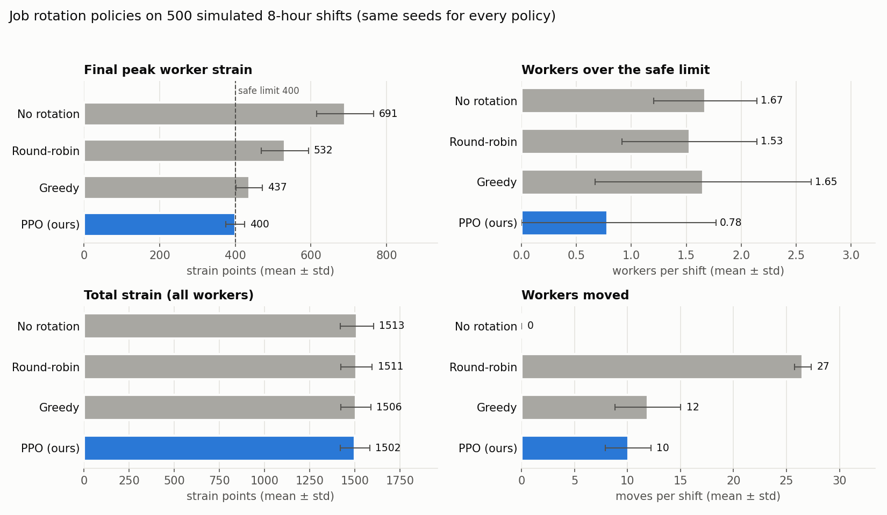
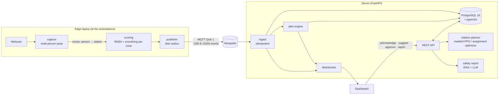

# ERGOSENSE

**Worker-first ergonomic safety for industrial workplaces.**
Webcams watch the workstations, every worker's posture risk is scored live with REBA, dangerous situations are
flagged the moment they happen, and job rotation is planned so nobody's cumulative strain crosses a safe limit.
No video ever leaves the workstation.

[](https://github.com/prawnsgupta/ERGOSENSE/actions/workflows/ergosense-ci.yml)




---

## Why

Work-related musculoskeletal disorders (back, shoulder, neck and wrist injuries) are the most common
occupational health problem in warehousing, manufacturing and textiles. They are caused by awkward postures
repeated for hours: bending to floor-level shelves, reaching overhead, twisting with a load, sitting hunched
over a machine. Today this risk is checked on paper a few times a year. A spot check sees a few minutes of
work; a supervisor sees output on a screen, not strain building up in a body. Help usually arrives after the
injury.

ERGOSENSE measures that exposure continuously with cheap, existing hardware (webcams and a laptop), shows it
to the supervisor while it is happening, and helps share hard work fairly, without blaming or surveilling
workers.

## What it does

| | |
|---|---|
| **Scores posture live** | MediaPipe body landmarks → joint angles → REBA score (1–15) and risk level, per worker, about once a second |
| **Tracks 10–15 workers at once** | One camera covers 3–5 workstations; each workstation is a *zone* on the image, so no face recognition is needed |
| **Flags danger immediately** | Red/amber alerts per worker: very high-risk posture, lifting while bent, high-risk posture held too long, strain near or over the shift limit |
| **Tracks cumulative strain** | Every minute of work adds strain according to its risk; a worker's total is compared with a safe shift limit |
| **Plans job rotation** | Suggests who should work where for the next hour, only into stations each worker is trained for; a supervisor approves every move |
| **Writes the shift report** | An LLM, grounded in ergonomic guidance by retrieval (RAG), writes an end-of-shift safety report in which every citation is verified |
| **Keeps working offline** | Events are buffered on disk if the network drops and delivered in order later; nothing is lost or counted twice |

## How it works



1. **Edge.** Each camera's frames go through a multi-person pose model. Every person standing in a workstation
   zone is scored with REBA; a 15-frame median removes single-frame errors. Only a small JSON event per worker
   per second leaves the laptop. Capture, scoring and publishing are separate OS processes joined by bounded
   queues.
2. **Transport.** Events travel over MQTT with at-least-once delivery. A local SQLite outbox keeps them while the
   broker is unreachable; unique event IDs make re-delivery harmless.
3. **Server.** Each event is stored and added to the worker's shift strain in one database transaction. The
   alert engine checks every worker's rules on every event and pushes changes to the dashboard instantly.
4. **Decisions.** The supervisor sees live scores, alerts and strain, asks for a rotation suggestion each hour,
   and approves it. Approval is a single locked transaction, so a plan can never be applied twice.
5. **Report.** At the end of the shift the facts from the database and the most relevant guidance are turned
   into a cited safety report.

## Danger alerts

| Level | Rule | Fires when |
|---|---|---|
| 🔴 Red | Very high-risk posture | REBA 11–15 held for 5 s |
| 🔴 Red | Lifting while bent | Bent or twisted (REBA ≥ 8) while handling a load for 3 s |
| 🔴 Red | Strain over limit | Cumulative shift strain reaches the limit (400) |
| 🟠 Amber | High-risk posture held | REBA 8–15 held for 30 s |
| 🟠 Amber | Strain near limit | Shift strain reaches 80% of the limit |

A rule must hold continuously before it fires, there is at most one open alert per worker and rule, and posture
alerts clear themselves after 10 s of safe work. All hold times are settings in `.env`.

## Results

**Rotation policies** – 500 simulated 8-hour shifts, 4 workers × 4 stations, identical seeds for every policy
(`python -m ergosense.rl.evaluate`):

| Policy | Final peak strain | Shifts with anyone over the limit | Workers moved per shift |
|---|---|---|---|
| No rotation | 691 ± 75 | 100% | 0 |
| Round-robin | 532 ± 62 | 100% | 26.5 |
| Greedy | 437 ± 35 | 86% | 11.9 |
| **Masked PPO** | **400 ± 25** | **48%** | **10.1** |

**12-worker site** (simulated cameras, real backend): 900 events stored with none lost, 137 alert episodes
raised and cleared, and a rotation that moved the most-strained workers to trained, lighter stations – projected
peak strain 410 vs 654 without rotation.

**Networking:** about 600 bytes per event against 921,600 bytes for one raw 640×480 frame (over 1,500× less).
With the broker stopped, every buffered event was delivered in order after it restarted.

**Tests:** 62 automated tests (REBA scoring incl. real recorded poses, outbox, database transactions, RL
environment, alerts, zones, large-site planner), run on every push.

> These results come from simulation and recorded poses. REBA from a webcam is an approximation and has not yet
> been validated against a trained ergonomics assessor; see [Limitations](#limitations).

## Quick start

Needs **Docker Desktop** and **Python 3.10**. Run everything from the repository root.

**Windows (PowerShell / VS Code terminal)**
```bash
py -3.10 -m venv .venv
.venv\Scripts\Activate.ps1
pip install -r ergosense/requirements.txt
Copy-Item .env.example .env
docker compose up -d
python -m ergosense.backend.init_db
python -m ergosense.assistant.ingest
```
**Mac / Linux:** the same with `python3.10 -m venv .venv`, `source .venv/bin/activate` and `cp .env.example .env`.

Then, in separate terminals:
```bash
python -m uvicorn ergosense.backend.main:app --port 8000
```
```bash
python -m ergosense.edge.pipeline --simulate --speed 60
```
Open **http://127.0.0.1:8000**. The simulated stations run an 8-hour shift in 8 minutes.

**Optional – a real LLM for the report:** install [Ollama](https://ollama.com/download) and run
`ollama pull llama3.1:8b`. Any OpenAI-compatible API also works (set `OPENAI_API_KEY`, `OPENAI_BASE_URL`,
`OPENAI_MODEL` in `.env`). Without one, a clearly labelled template report is produced.

## Using it with real workers

1. **Describe your site** – copy [`sites/example_12_workers.json`](sites/example_12_workers.json) and fill in your
   stations, pseudonymous worker codes, who is trained for which station and who starts where:
   ```bash
   python -m ergosense.backend.init_db --new-shift --site sites/your_site.json
   ```
2. **Draw the zones for each camera** – SPACE freezes the picture, drag a box around each workstation, type the
   station id and the load handled there, S saves:
   ```bash
   python -m ergosense.edge.zone_setup --camera 0 --out zones/cam1.json
   ```
3. **Start one pipeline per camera** (real time):
   ```bash
   python -m ergosense.edge.pipeline --zones zones/cam1.json
   ```
   The multi-person pose model (~9 MB) is downloaded once on the first run.
4. Watch the dashboard: alerts, strain, rotation suggestions and the end-of-shift report.

Camera placement: side-on or about 45° to the workers, 2–3 m away, head to feet in view, zones not overlapping.
Other sources: `--station S4` (one worker per camera), `--video clip.mp4`, `--replay <recordings>`,
`--simulate --site sites/your_site.json`. See `python -m ergosense.edge.pipeline --help` and
[docs/DEMO_CHECKLIST.md](docs/DEMO_CHECKLIST.md).

## Privacy and worker protection

- Video is processed on the edge laptop and never stored or transmitted; only scores leave the device.
- Workers are identified by station zone and pseudonymous codes, not faces or names.
- The system only proposes; a supervisor approves every rotation, and rotations are restricted to stations a
  worker is trained for.
- ERGOSENSE is meant to improve working conditions and work allocation – not to rank workers or measure who can
  tolerate the most pain. Sites that deploy it should agree this in writing with workers and the safety committee.

## Technology

| Area | Tools and techniques |
|---|---|
| Computer vision | MediaPipe Pose / PoseLandmarker (33 3-D landmarks, several people per frame), OpenCV, REBA |
| Edge and OS | Python multiprocessing, bounded producer–consumer queues, SQLite outbox |
| Networking | MQTT (Eclipse Mosquitto, QoS 1, persistent sessions), WebSockets |
| Database | PostgreSQL 16 (transactions, row locks, partial indexes, JSONB), pgvector |
| Reinforcement learning | Gymnasium, Stable-Baselines3 MaskablePPO with invalid-action masking; Hungarian assignment (SciPy) for larger sites |
| Generative AI | Retrieval-augmented generation (sentence-transformers + pgvector), Ollama or OpenAI-compatible LLMs, citation verification |
| Backend and UI | FastAPI, Uvicorn, vanilla JS dashboard |
| Infrastructure and testing | Docker Compose, pytest, GitHub Actions |

## Repository layout

```
ergosense/
  edge/        pose capture, multi-person zones, REBA scoring, MQTT publisher, outbox, simulator, zone setup tool
  backend/     FastAPI app, MQTT ingest, alert engine, database schema and queries, rotation approval
  rl/          shift environment, PPO training and evaluation, baselines, assignment optimizer, trained model
  assistant/   guidance documents, retrieval, LLM providers, report generator
  dashboard/   web dashboard
  tests/       62 tests
sites/         site description files (workers, stations, training)
docs/          demo checklist, project guide, viva notes
infra/         Mosquitto configuration
docker-compose.yml, .env.example
features.py, dataset/, weights/ ...   pose-feature utilities and the recorded pose dataset used for replay,
                                      REBA validation and station calibration
```

## API

`GET /health` · `GET /workers` · `GET /stations` · `GET /state` · `GET /events?worker_id=&limit=` ·
`GET /shifts/{id}/strain` · `GET /alerts` · `POST /alerts/{id}/ack` · `POST /rotation/suggest` ·
`POST /rotation/{plan_id}/approve` · `GET /rotation/plans` · `POST /report/{shift_id}` · `WS /ws`.
Interactive documentation at http://127.0.0.1:8000/docs.

## Limitations

- **Webcam REBA is an approximation.** Depth is the least reliable axis, wrist detail is coarse, and load, grip
  and shoulder elevation cannot be seen, so they are set per station.
- **Seated, wrist-heavy work** (sewing, fine assembly) is not assessed well by REBA; RULA and hand tracking are planned.
- **Crowded zones:** when workers overlap or block each other, scores become less reliable.
- **Rotation results come from simulation.** Live station strain rates are measured from real events, but
  individual worker sensitivity is unknown.
- The strain weights and the 400-point limit are design parameters, not clinical thresholds.
- Authentication and TLS are not configured; services are bound to localhost by default.

## Roadmap

- [x] Live REBA scoring, strain tracking, offline-safe event pipeline
- [x] Several workers per camera with station zones
- [x] Live danger alerts and dashboard
- [x] Rotation planning for 4–15 workers with supervisor approval
- [x] Cited end-of-shift safety report
- [ ] Workstation sensor pod (ESP32: temperature, humidity, light) with an LED alert tower
- [ ] RULA and hand tracking for seated work
- [ ] Validation against a trained ergonomics assessor and a consent-based field pilot

## References

- Hignett, S., & McAtamney, L. (2000). Rapid Entire Body Assessment (REBA). *Applied Ergonomics*, 31(2), 201–205.
- McAtamney, L., & Corlett, E. N. (1993). RULA: A survey method for the investigation of work-related upper limb disorders. *Applied Ergonomics*, 24(2), 91–99.
- Waters, T. R., Putz-Anderson, V., Garg, A., & Fine, L. J. (1993). Revised NIOSH equation for the design and evaluation of manual lifting tasks. *Ergonomics*, 36(7), 749–776.
- Schulman, J., et al. (2017). Proximal policy optimization algorithms. arXiv:1707.06347.
- Huang, S., & Ontañón, S. (2022). A closer look at invalid action masking in policy gradient algorithms. *FLAIRS-35*.
- Kuhn, H. W. (1955). The Hungarian method for the assignment problem. *Naval Research Logistics Quarterly*, 2(1–2), 83–97.
- Lewis, P., et al. (2020). Retrieval-augmented generation for knowledge-intensive NLP tasks. *NeurIPS 33*.

## Team

Team 55, RV College of Engineering – Experiential Learning, UN SDG 9.
Priyansh Gupta · Nidikirana N · Soorya Anvekar Natarajan · Joshua — mentored by Dr. Chethana R Murthy.

## Acknowledgements

The pose-feature utilities and the recorded pose dataset come from the team's earlier exercise-recognition
work by Soorya Natarajan ([details](FITCV_README.md)). The guidance documents in `ergosense/assistant/docs/` are
our own summaries of published ergonomic methods.
