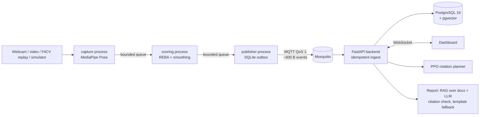

# ERGOSENSE — industrial worker ergonomic safety system (UN SDG 9)

A webcam watches a worker, scores posture risk with **REBA**, streams tiny JSON events over **MQTT**,
stores them in **PostgreSQL**, tracks cumulative strain per worker, uses **reinforcement learning (PPO)**
to suggest job rotations, and writes an end-of-shift report with an **LLM + RAG**.
Built on top of [FitCV](FITCV_README.md) (MediaPipe pose pipeline, angle helpers, recorded pose dataset).



## Results so far (all reproducible)
- **54 automated tests pass** (`python -m pytest`), incl. REBA on real FitCV poses, idempotent ingest,
  atomic plan approval and a concurrent double-approval test.
- **Bandwidth:** ~600 B per event vs 921,600 B per raw 640x480 frame (~1,540x smaller).
- **Resilience:** broker stopped mid-stream → 96 events buffered on disk, all 192 delivered in order;
  backend stopped → broker queued 48 events (persistent session), all delivered on restart.
- **RL (500 seeded shifts):** final peak strain — no rotation 672, round-robin 523, greedy 429,
  **PPO 395**; workers over the limit 1.67 / 1.46 / 1.44 / **0.62**; moves 0 / 27 / 12 / **10**.
  Chart: `ergosense/rl/results/policy_comparison.png`.
- **Calibration:** loading bay (S4) from 527 real FitCV pose events: 79.5 strain/h (simulator model: 77.4).
- **Live end-to-end run** (`python -m ergosense.e2e_check`, hourly PPO decisions): peak 362 vs 616
  projected without rotation; nobody over the 400 limit.

## Setup (once)
Run these in **PowerShell** (or the VS Code terminal) in the repo folder `D:\Downloads\College\EL\ERGOSENSE`.
```bash
py -3.10 -m venv .venv
.venv\Scripts\Activate.ps1
pip install -r ergosense/requirements.txt
Copy-Item .env.example .env
docker compose up -d
python -m ergosense.backend.init_db
python -m ergosense.assistant.ingest
```
Mac/Linux: `python3.10 -m venv .venv && source .venv/bin/activate`, `cp .env.example .env`; the rest is the same.
Already done on this laptop: venv, packages, containers, DB, RAG ingest, trained PPO model.

## Run (each in its own terminal, venv activated)
1. Backend + dashboard: `python -m uvicorn ergosense.backend.main:app --port 8000` → open http://127.0.0.1:8000
2. Simulated stations S1–S3: `python -m ergosense.edge.pipeline --simulate --stations S1,S2,S3 --speed 60`
3. Webcam at the loading bay: `python -m ergosense.edge.pipeline --station S4 --demo-speed 60 --load-kg 8`
   (no camera? use `--video clip.mp4` or `--replay dataset/BentOverRow`)

Useful: `python -m pytest` · `python -m ergosense.e2e_check` · `python -m ergosense.rl.evaluate` ·
`python -m ergosense.backend.init_db --new-shift` (fresh shift for a demo).

## Limitations
REBA from a single webcam is an approximation (depth is the weakest axis: put the camera side-on or at 45°;
load, grip and shoulder shrug must be entered by hand). RL results come from a simulator (one station calibrated
on real poses). Posture labels are rule-based. Strain limit 400 is a design parameter, not a clinical limit.
Big Data, cloud and NLP are out of scope.

*Work in progress: full documentation (technology mapping, demo script, docs/VIVA_NOTES.md) still to be written.*
